<picture>
  <source media="(prefers-color-scheme: dark)" srcset="docs/_static/qpdk_logo_dark.svg">
  
</picture>

<!-- BADGES:START -->

[](https://gdsfactory.github.io/quantum-rf-pdk/)
[](https://gdsfactory.github.io/quantum-rf-pdk/qpdk.pdf)
[](https://mybinder.org/v2/gh/gdsfactory/quantum-rf-pdk/HEAD)
[](https://pypi.org/project/qpdk/)
[](https://choosealicense.com/licenses/mit/)
[](https://gdsfactory.github.io/quantum-rf-pdk/)
[](https://github.com/gdsfactory/quantum-rf-pdk/actions/workflows/test.yml)
[](https://github.com/gdsfactory/quantum-rf-pdk/actions/workflows/drc.yml)
[](https://codecov.io/github/gdsfactory/quantum-rf-pdk)
[](https://github.com/gdsfactory/quantum-rf-pdk/actions/workflows/test.yml)

<!-- BADGES:END -->

______________________________________________________________________

**QPDK** is an open-source process design kit (PDK) for superconducting quantum RF applications built on
[gdsfactory](https://gdsfactory.github.io/gdsfactory/). It provides a library of parametric quantum circuit components
(transmon qubits, CPW resonators, Josephson junctions, etc.), analytical S-parameter models, routing utilities, and
test-chip examples.

QPDK gives researchers, engineers, and students a scriptable, version-controlled foundation to go from concept to GDSII
in minutes.

## Key Features

- **Rich component library** — Transmons, fluxonium, unimon qubits, CPW resonators, interdigital capacitors, SQUID
  junctions, launchers, bump bonds, TSVs, and more.
- **Parametric & composable** — Combine Python functions (`@gf.cell`) into hierarchical designs or define full chips in
  YAML.
- **Analytical circuit models** — Fast, differentiable S-parameter simulations powered by
  [SAX](https://gdsfactory.github.io/sax/) and [JAX](https://github.com/jax-ml/jax).
- **Automated routing** — CPW-aware routing strategies with auto-tapers for complex layouts.
- **KLayout integration** — Layer definitions, technology files, and cross sections for immediate visual inspection.
- **Regression-tested** — GDS regression tests, netlist checks, and model validation.
- **Notebook-driven workflows** — Jupyter notebooks for frequency modeling, tolerance analysis, parameter extraction,
  pulse-level simulation, and optimization.
- **[GDSFactory+](https://gdsfactory.com/plus/) integration** — Seamlessly design, verify, and validate chips with the
  enhanced commercial extension. Includes access to 43+ foundry PDKs, graphical layout and schematic editors directly in
  VSCode, an AI assistant, and comprehensive verification tools (DRC, LVS, Connectivity checks). See the
  [QPDK graphical workflow tutorial](https://gdsfactory.com/plus/v2/tutorial/design/graphical-workflow/design-quantum-rf/#explore-and-simulate-a-resonator).

## Notable Components

QPDK ships with a broad set of ready-to-use superconducting circuit components. Browse all the components in the
[documentation](https://gdsfactory.github.io/quantum-rf-pdk/cells.html).

### Qubits

|                   Transmon                    |                    Fluxonium                    |
| :-------------------------------------------: | :---------------------------------------------: |
|     Double-pad capacitively shunted qubit     |          Superinductance-shunted qubit          |
| 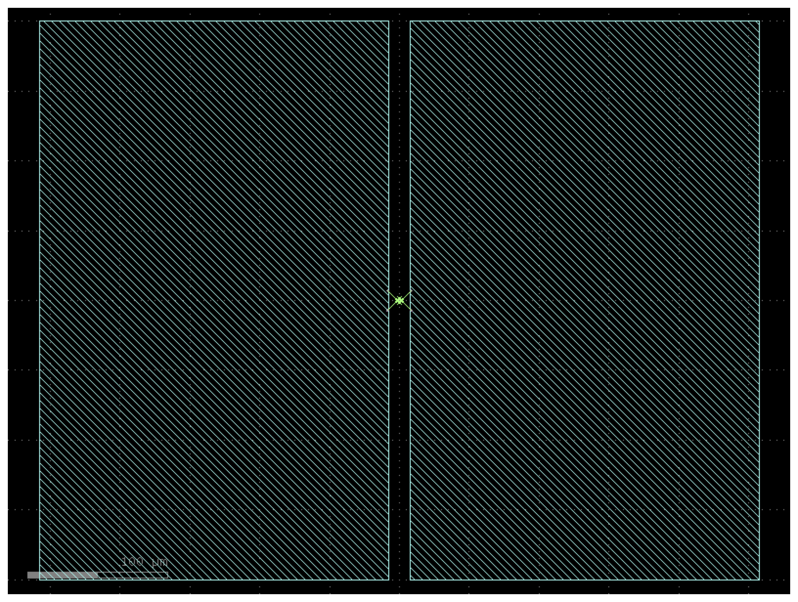 | 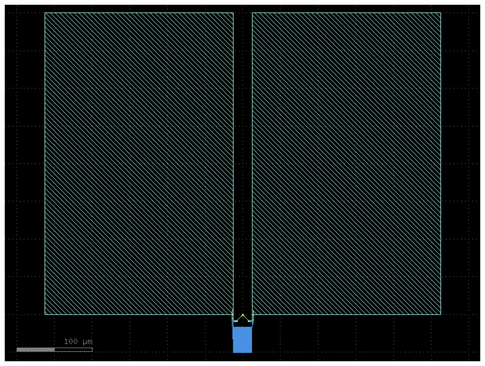 |

|                  Unimon                   |                   SQUID Junction                    |
| :---------------------------------------: | :-------------------------------------------------: |
|     Resonator-embedded junction qubit     |     Superconducting quantum interference device     |
| 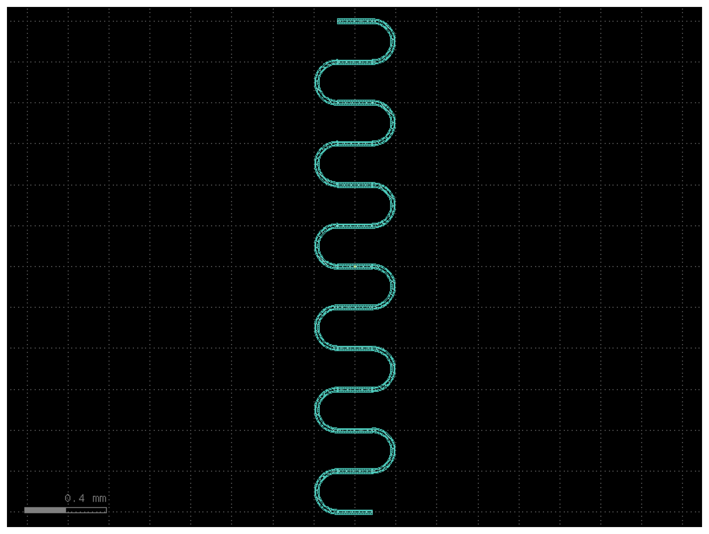 | 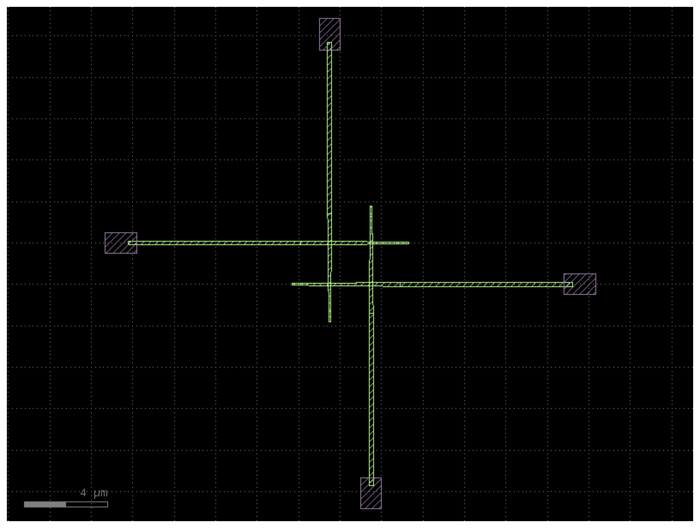 |

### Passive Components

|                    CPW Resonator                    |                    Interdigital Capacitor                    |
| :-------------------------------------------------: | :----------------------------------------------------------: |
|       Meandering coplanar waveguide resonator       |            Finger-style lumped-element capacitor             |
| 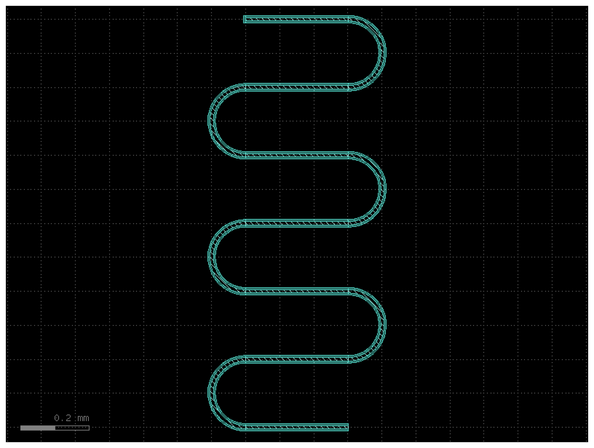 | 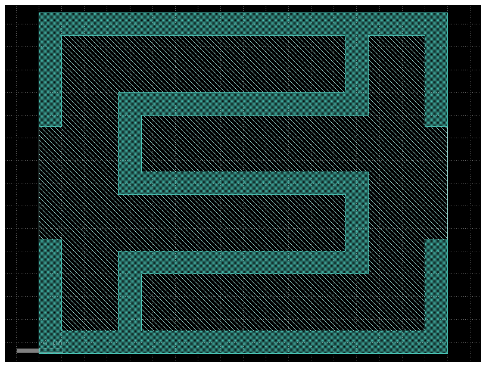 |

### Composite Components

**Transmon with Resonator & Probeline** — Qubit cell with coupled resonator and probeline section:

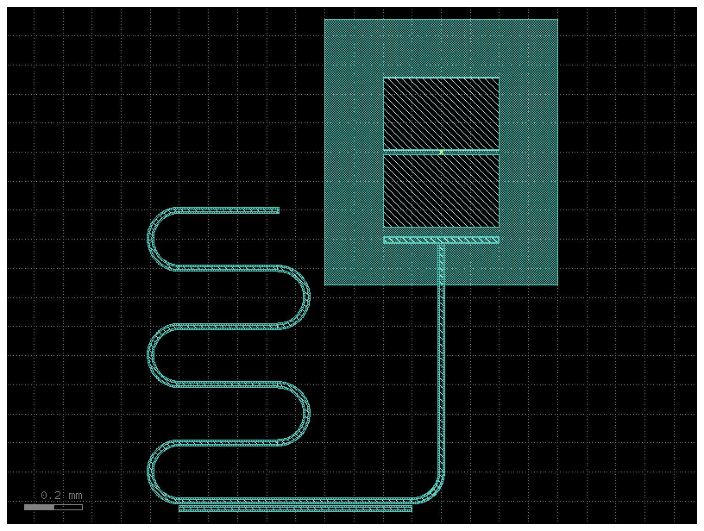

## Sample Test Chips

QPDK includes some complete, tapeout-ready test chip examples that demonstrate real-world design workflows.

### Qubit Test Chip

A four-transmon test chip with coupled readout resonators, probeline routing, flux lines, and launchers. Defined
entirely in YAML.

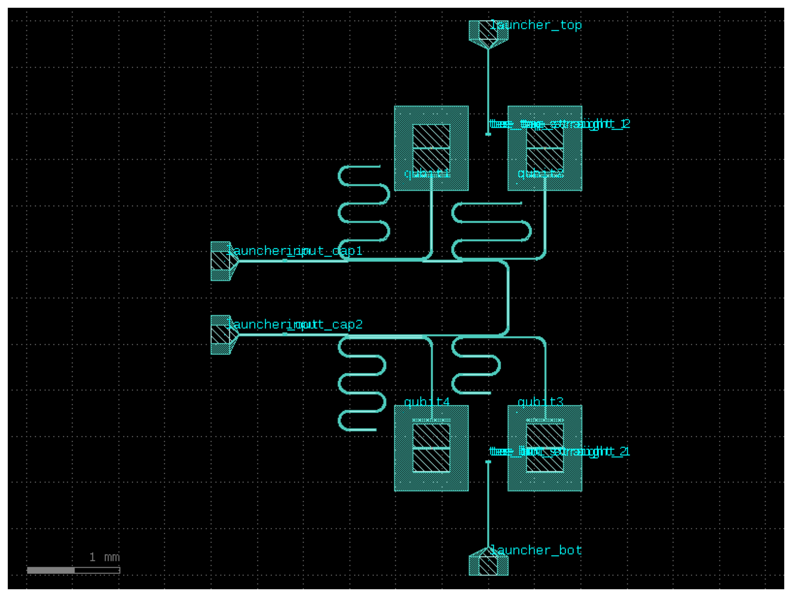

### Filled Qubit Test Chip

The same qubit test chip with magnetic vortex trapping holes filling the ground plane and chip edges.

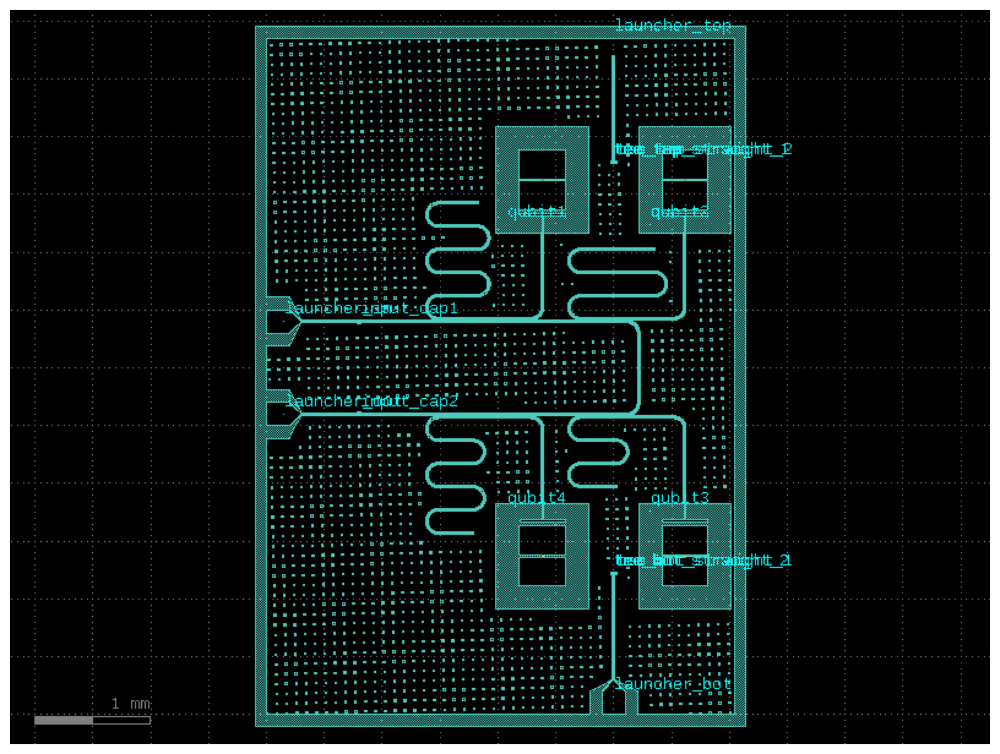

### Flip-Chip (Flipmon) Test Chip

A four-flipmon test chip demonstrating flip-chip qubit integration with coupled readout resonators, interdigital
capacitor inputs, probeline routing, and flux lines — shown here with ground-plane filling and chip edges.

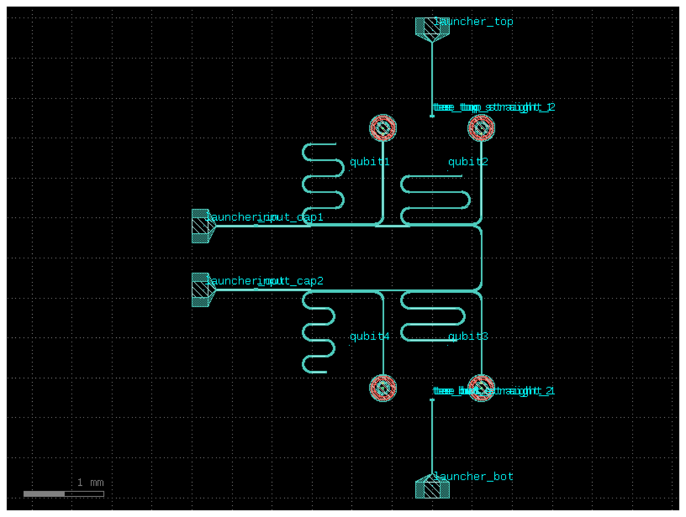

### Resonator Test Chip

A 16-resonator characterization chip with systematically varied CPW widths and gaps across two probelines. Ideal for
extracting loss tangents and kinetic inductance. Also check
[the notebook demonstrating network model simulations and fabrication tolerance Monte Carlo](https://gdsfactory.github.io/quantum-rf-pdk/notebooks/monte_carlo_fabrication_tolerance.html).

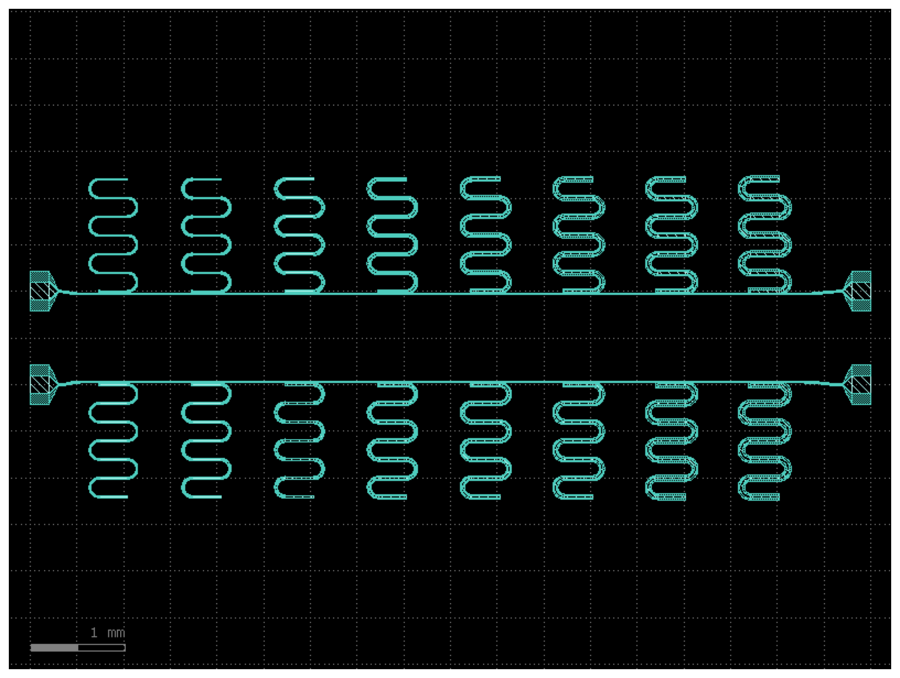

## Simulation Showcase

QPDK comes with worked examples for circuit, quantum, and electromagnetic simulation. Every figure below is taken from
one of the [example notebooks](https://gdsfactory.github.io/quantum-rf-pdk/notebooks.html) as rendered in the
documentation. Click a title to open the full notebook.

### Circuit & Network Models

|     [Resonator Test Chip Transmission][nb-mc]     |     [Fabrication Tolerance Monte Carlo][nb-mc]     |
| :-----------------------------------------------: | :------------------------------------------------: |
| Both probelines of the 16-resonator chip, via SAX | Resonance spread from CPW width and gap variations |
|   ![Resonator test chip transmission][img-s21]    |      ![Monte Carlo frequency spread][img-mc]       |

### Quantum Dynamics & Hamiltonians

|     [Flux-Tunable Transmon Spectrum][nb-scq]     |    [Pulse-Level Gate Simulation][nb-qutip]     |
| :----------------------------------------------: | :--------------------------------------------: |
| Energy levels versus external flux with scQubits |  X-gate populations and leakage in QuTiP-QIP   |
|    ![Flux-tunable transmon spectrum][img-scq]    | ![QuTiP X-gate population dynamics][img-qutip] |

|             [Dispersive Shift][nb-pmb]             |    [Differentiable Transmon Optimization][nb-clx]    |
| :------------------------------------------------: | :--------------------------------------------------: |
| Block-diagonalized dispersive shift with Pymablock | Circulax JAX gradients to target f and anharmonicity |
|       ![Pymablock dispersive shift][img-pmb]       |    ![Circulax optimization convergence][img-clx]     |

### Electromagnetic Field Solvers

|     [COMSOL Resonator][nb-cres]     |     [HFSS Eigenmode][nb-hfss]     |    [Elmer Capacitance][nb-elmer]    |
| :---------------------------------: | :-------------------------------: | :---------------------------------: |
|     Driven E-field at resonance     |   Meandered CPW eigenmode field   |  IDC capacitance vs. FEM remeshing  |
| ![COMSOL resonator field][img-cres] | ![HFSS eigenmode field][img-hfss] | ![Elmer IDC convergence][img-elmer] |

**[COMSOL Transmon Capacitance][nb-cqub]** — Electrostatic potential and field around the double-pad transmon:

![COMSOL transmon potential][img-cqub]

The same workflows extend to
[HFSS driven-modal](https://gdsfactory.github.io/quantum-rf-pdk/notebooks/hfss_driven_capacitor.html) and
[Q2D impedance](https://gdsfactory.github.io/quantum-rf-pdk/notebooks/hfss_q2d_cpw_impedance.html) analyses,
[Qucs-S model validation](https://gdsfactory.github.io/quantum-rf-pdk/notebooks/model_comparison_to_qucs.html), and
[NetKet](https://gdsfactory.github.io/quantum-rf-pdk/notebooks/netket_transmon_design.html) and
[Optuna](https://gdsfactory.github.io/quantum-rf-pdk/notebooks/optimize_capacitor_optuna.html) optimization.

## Quick Start

```python
import gdsfactory as gf
from qpdk import PDK

PDK.activate()

# Create a transmon qubit
from qpdk.cells.transmon import double_pad_transmon

qubit = double_pad_transmon(pad_size=(250, 400), pad_gap=15)
qubit.plot()
```

```python
# Build a complete test chip from YAML
from gdsfactory.read import from_yaml
from qpdk import tech

chip = from_yaml(
    "qpdk/samples/qubit_test_chip.pic.yml",
    routing_strategies=tech.routing_strategies,
)
chip.show()  # Opens in KLayout
```

### Graphical Workflow with GDSFactory+

Prefer a visual workflow? QPDK runs in [GDSFactory+](https://gdsfactory.com/plus/), where you can place components in
the schematic editor, inspect the layout, and run circuit simulations without leaving VSCode. The
[Quantum-RF graphical workflow tutorial](https://gdsfactory.com/plus/v2/tutorial/design/graphical-workflow/design-quantum-rf/#explore-and-simulate-a-resonator)
walks through exploring and simulating a resonator with QPDK step by step.

## Examples & Notebooks

- **[PDK cells in the documentation](https://gdsfactory.github.io/quantum-rf-pdk/cells.html)** — Collection of all
  available geometries.
- **[`qpdk/samples/`](https://github.com/gdsfactory/quantum-rf-pdk/tree/main/qpdk/samples)** — Example layouts and
  simulations including qubit test chips, resonator arrays, routing demos, and 3D export.
- **[`notebooks/`](https://gdsfactory.github.io/quantum-rf-pdk/notebooks.html)** — Jupyter notebooks covering:
  - Resonator frequency modeling and S-parameter analysis
  - Circuit simulation with [SAX](https://github.com/flaport/sax)
  - Monte Carlo fabrication tolerance analysis
  - Hamiltonian parameter extraction with [scqubits](https://github.com/scqubits/scqubits)
  - Pulse-level quantum gate simulation with [QuTiP](https://qutip.org/)
  - Capacitor geometry optimization with [Optuna](https://optuna.org/)
  - Dispersive shift calculation with [Pymablock](https://pymablock.readthedocs.io/en/latest/)
  - Transmon design optimization with [NetKet](https://www.netket.org/)
- **[GDSFactory+ Quantum-RF tutorial](https://gdsfactory.com/plus/v2/tutorial/design/graphical-workflow/design-quantum-rf/#explore-and-simulate-a-resonator)**
  — Graphical design and simulation of a resonator with QPDK in GDSFactory+.
- **[gsim example notebooks](https://gdsfactory.github.io/gsim/)** — Electromagnetic simulation examples using Palace
  and Meep with gdsfactory.

## Installation

We recommend using [`uv`](https://astral.sh/uv/) for package management. [`just`](https://github.com/casey/just) is used
for project-specific recipes.

### Installation for Users

Install the package with:

```bash
uv pip install qpdk
```

Or with pip:

```bash
pip install qpdk
```

Optional dependencies for the analytical models and simulation tools (SAX, scqubits, JAX) can be installed with:

```bash
uv pip install "qpdk[models]"
```

`models` is one of several extras — `hfss`, `circulax`, `netket`, `pymablock`, `qutip`, `ray`, `scqubits` and `graphics`
pull in the remaining simulation backends, and extras compose (`"qpdk[models,netket]"`). See
[Installing optional extras](https://gdsfactory.github.io/quantum-rf-pdk/notebooks.html#installing-optional-extras) for
what each one installs and which notebooks need it.

### KLayout Technology Installation

To use the PDK in KLayout (for viewing GDS files with correct layers and technology settings), install the technology
files:

```bash
python -m qpdk.install_tech
```

> [!NOTE]
> After installation, restart KLayout to ensure the new technology appears.

### Installation for Contributors

For contributors, please follow the [installation and development workflow instructions](docs/contributing.md).

## Project Structure

```text
quantum-rf-pdk/
├── qpdk/               Core Python package
│   ├── cells/          Component definitions (transmons, resonators, capacitors, …)
│   ├── models/         Analytical models, mostly S-parameters
│   ├── samples/        Example layouts and complete test chips
│   ├── klayout/        KLayout technology files
│   └── tech.py         Layer stack, cross sections, routing strategies
├── tests/              Regression, integration and unit tests
├── notebooks/          Jupyter notebooks for design and simulation workflows
└── docs/               Sphinx documentation (HTML + PDF)
```

## Documentation

- [QPDK documentation (HTML)](https://gdsfactory.github.io/quantum-rf-pdk/)
- [QPDK documentation (PDF)](https://gdsfactory.github.io/quantum-rf-pdk/qpdk.pdf)
- [gdsfactory documentation](https://gdsfactory.github.io/gdsfactory/)

## Contributing

We welcome contributions of all sizes: new components, improved models, bug fixes, documentation, and notebook
tutorials. Please see the [contributing guide](docs/contributing.md) to get started.

To build a PDK for your own fabrication process on top of QPDK, see
[Customizing QPDK for Your Process](docs/customizing.md).

## Support

For commercial support, training, and custom PDK development, please visit
[gdsfactory+ (gdsfactory.com/plus)](https://gdsfactory.com/plus/).

## License

QPDK is released under the [MIT License](LICENSE).

[img-clx]: docs/_static/images/sim_circulax_optimization.svg
[img-cqub]: docs/_static/images/sim_comsol_qubit_potential.webp
[img-cres]: docs/_static/images/sim_comsol_resonator_field.webp
[img-elmer]: docs/_static/images/sim_elmer_idc_convergence.svg
[img-hfss]: docs/_static/images/hfss_eigenmode_resonator_field.jpg
[img-mc]: docs/_static/images/sim_monte_carlo_frequency_spread.svg
[img-pmb]: docs/_static/images/sim_pymablock_dispersive_shift.svg
[img-qutip]: docs/_static/images/sim_qutip_x_gate.svg
[img-s21]: docs/_static/images/sim_resonator_chip_transmission.svg
[img-scq]: docs/_static/images/sim_scqubits_flux_spectrum.svg
[nb-clx]: https://gdsfactory.github.io/quantum-rf-pdk/notebooks/circulax_transmon_optimization.html
[nb-cqub]: https://gdsfactory.github.io/quantum-rf-pdk/notebooks/comsol_qubit_capacitance.html
[nb-cres]: https://gdsfactory.github.io/quantum-rf-pdk/notebooks/comsol_cpw_resonator.html
[nb-elmer]: https://gdsfactory.github.io/quantum-rf-pdk/notebooks/elmer_capacitance_interdigital.html
[nb-hfss]: https://gdsfactory.github.io/quantum-rf-pdk/notebooks/hfss_eigenmode_resonator.html
[nb-mc]: https://gdsfactory.github.io/quantum-rf-pdk/notebooks/monte_carlo_fabrication_tolerance.html
[nb-pmb]: https://gdsfactory.github.io/quantum-rf-pdk/notebooks/pymablock_dispersive_shift.html
[nb-qutip]: https://gdsfactory.github.io/quantum-rf-pdk/notebooks/qutip_qip_pulse_simulation.html
[nb-scq]: https://gdsfactory.github.io/quantum-rf-pdk/notebooks/scqubits_parameter_calculation.html
